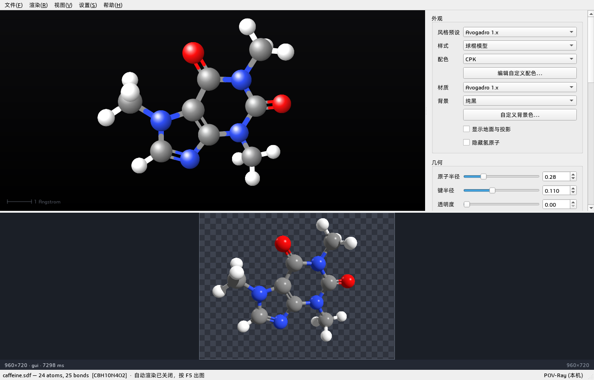

# MolPOV

分子结构查看器 + POV-Ray 实时预览。左侧是可拖拽旋转的分子视口，右侧是渲染参数，下方是
POV-Ray 按当前参数渲染出来的画面；拖动参数或旋转视角后自动重渲染（防抖），最后可一键出
高质量大图。



## 特性

- **读取 XYZ / PDB / MOL / SDF**，自动按共价半径推断成键，MOL/SDF 使用文件里的显式键。
- **读取 POV-Ray 场景**：从 `.pov` 里解析 `sphere` 几何、按颜色反推元素、按距离感知成键，
  并按“并行圆柱的数量”恢复双键/三键（Avogadro 与 MolPOV 都会用 2/3 根圆柱表示多键）；还会
  读出相机、背景色，并识别 Avogadro 风格的材质/双灯。导入后直接在当前界面复现并继续调参。
- **原样渲染 Avogadro POV**：菜单“渲染 → 原样渲染 Avogadro POV…”不重建几何，直接把选中的
  `.pov` 交给同一个 `pvengine64.exe`；渲染后保持在该场景上，**相机、背景、输出宽度、透明背景
  可调**（改完 Ctrl+Enter / F5 会把当前设置补丁进原 SDL 再渲染），材质、灯光、原子尺寸仍按
  文件原样保留。未改动参数时重渲染用的就是原始文件。
- **三种表示**：球棍、空间填充、线框；可一键**隐藏氢原子**（连同与氢相连的键一起隐藏）；三套内置配色（CPK / VMD 青碳 / 粉彩）外加
  **自定义配色**（按元素逐个取色，未指定的元素回落到 CPK）；五种材质（哑光 / 标准 / 高光 /
  金属 / **Avogadro 1.x**）；五种背景（影棚灰 / 深色 / 纯白 / 纯黑 / 透明）；
  球棍支持双键/三键平行圆柱。
- **风格预设**：`影棚`、`Avogadro 1.x` 两套成套外观（材质 + 光照 + 背景 + 地面 + 追踪深度
  一次设好），手动改动任一控件后自动切到“自定义”，避免把互不搭的材质和光照拼在一起。
- **两套光照 + 可叠加头灯**：影棚三灯（主光为面光源，可调方位/高度/强度/阴影柔化），或
  **Avogadro 双灯**——两盏跟随相机的平行光，和 Avogadro 1.x 的 POV-Ray 导出行为一致；
  另有独立的**头灯**（相机位置的平行光，强度可调），可与任一模式同时开启。
- **透明度**：整场 `rgbt` 半透明（0–0.85），视口同步做半透明预览。
- **三灯布光**：主光（面光源，可调方位、高度、强度、阴影柔化）、补光、轮廓光。
- **几何打包**：不透明场景包成一个 `union`，交给 POV-Ray 自动包围盒（343 原子实测约快 2%，
  小分子基本无差别）；开启透明度时自动退回散件，避免 CSG 伪影。
- **实时交互**：左键旋转、右键或滚轮缩放、双击复位；视口用 CPU 光栅化，POV-Ray 负责出图。
- **防抖预览**：参数停止变化（默认 0.7 s，可调 0.3/0.7/1.5/3 s）后自动出预览；拖动视口时
  只更新实时画面，松手才触发渲染；新请求会立刻取消上一张过时的预览（高质量渲染不会被取消）。
  “渲染”菜单里的“自动渲染”（Ctrl+Shift+A）可关闭，改成按 F5 手动出图；
  **默认就是关闭的**，启动后参数和视角变化不会自动出图。
- **高质量渲染**：抗锯齿 + 可选 radiosity，导出 PNG；保存图片时是否同时写一个同名
  `.pov`，由“设置 → 导出图片时同时导出 POV”统一控制。
- **设置菜单**：“设置 POV-Ray 路径…”（可指定 `pvengine64.exe` 或控制台版 `povray.exe`，
  QSettings 记忆；“自动检测 POV-Ray”清除该设置）+“设置工作目录…”（打开/保存/导入对话框的
  默认目录）+“在文件管理器中打开工作目录”；“导出图片时同时导出 POV”是持久开关。
  路径优先级：设置里的显式路径 > 环境变量 `MOLPOV_POVRAY` > 自动探测 > WSL。
- **Avogadro 完整命令行模式**：勾选“完整命令行 (Avogadro 同款)”后，渲染改用
  `+Q9 +A +AM2 +UA`（GUI 后端还会带 `+V +D +P +UD +UL +UV`，窗口被隐藏、渲染完成后
  由工具结束进程）；导入 `.pov` 时会自动开启该模式，并按 1024×768 复现原图。CLI 对应
  `--full-command`。
- **三种 POV-Ray 后端**：本机控制台版 `povray.exe`（最快）；本机 Windows 图形版
  `pvengine64.exe`（官方安装包默认形态，用 `/RENDER ... /EXIT` 批量调用，并自动处理启动
  对话框）；WSL 里的 `povray`（常驻守护进程，省去每次 `wsl.exe` 的启动开销）。

## 与 Avogadro 1.x 的关系

参考版本：Avogadro **1.2.0** 源码包。

- **材质**：`Avogadro 1.x` 预设的 `finish` 逐字取自
  `libavogadro/src/extensions/povpainter.cpp` 里的
  `#default { finish { ambient .8 diffuse 1 specular 1 roughness .005 metallic 0.5 } }`。
  这一行是观感的主要来源：高环境光 + 近镜面高光 + 半金属。
- **光照**：常量逐字取自 `libavogadro/src/global.h`：

  | 常量 | 值 |
  | --- | --- |
  | `LIGHT_AMBIENT` | `{0.2, 0.2, 0.2, 1.0}` |
  | `LIGHT0_DIFFUSE` / `LIGHT0_POSITION` | `{1, 1, 1, 1}` / `{0.8, 0.7, 1.0, 0.0}` |
  | `LIGHT1_DIFFUSE` / `LIGHT1_POSITION` | `{0.3, 0.3, 0.3, 1}` / `{-0.8, 0.7, -0.5, 0.0}` |

  位置是**眼空间方向**（`w = 0`，即平行光）；Avogadro 用相机矩阵把它们转到世界坐标，
  我们也一样（眼空间 `+z` 朝观察者，对应我们基向量的 `-forward`）。两盏灯都是
  `parallel` + `fade_power 0`，并指向分子中心。
- **预设**：`Avogadro 1.x` 会把材质、双灯、纯黑背景、无地面、`max_trace_level 15` 一起设好。
  黑底来自它的 GL 清屏色（`GLWidgetPrivate` 里默认 `QColor(0,0,0)`），这一项对还原观感影响
  最大——浅灰渐变背景会把高光和轮廓冲淡。
- **可调项**：主光/补光强度滑杆在 Avogadro 模式下按相对比例缩放（默认 1.15 / 0.35 时正好
  还原上游的 1.0 / 0.3 两档），所以默认值就是精确复刻。
- 上游是 GPL-2.0；这里只是把参数值当数据重写，没有拷贝代码。

## 环境与依赖

需要 Python 3.10+ 和 PySide6：

```bash
pip install PySide6
```

还需要一个能调用的 POV-Ray。程序按下面的顺序自动探测：

1. **控制台版 `povray.exe`（最快）**：环境变量 `MOLPOV_POVRAY` 指向它，或放在 PATH 里，
   或位于 `D:\POV-Ray\<版本>\bin`、`C:\Program Files\POV-Ray\<版本>\bin`。
2. **本机 Windows 图形版（默认可用）**：例如 `D:\POV-Ray\v3.7`。官方 Windows 安装包只带
   `pvengine64.exe`，程序会用 `/RENDER ... /EXIT` 批量模式驱动它，并自动关掉启动时
   “internal editor 未加载”的提示框；窗口以隐藏方式启动，不会闪。
3. **WSL 里的命令行版**：`wsl -d Ubuntu -u root -- bash -lc "apt-get install -y povray"`，
   程序会自动发现并启动常驻渲染守护进程。

用 `python -m molpov.cli --backend-info` 查看当前识别到的后端。可用环境变量
`MOLPOV_BACKEND=native|gui|wsl` 强制指定，`MOLPOV_POVRAY_DIR` 指定安装根目录。

## 使用

```bash
python -m molpov                      # 打开示例分子（咖啡因）
python -m molpov samples/benzene.xyz  # 打开指定文件
python -m molpov upload/CA.pov        # 直接把 .pov 当结构打开
```

命令行渲染（不开界面，适合批处理）：

```bash
python -m molpov.cli samples/caffeine.sdf --render out.png --width 1200
python -m molpov.cli samples/caffeine.sdf --pov scene.pov --preview --width 640
python -m molpov.cli samples/caffeine.sdf --render out.png --color C=ff8800 --color O=2288ff
python -m molpov.cli --render-pov upload/CA.pov --render CA.png --width 1024
```

`--render-pov` 会打印实际使用的完整命令行。注意 POV-Ray for Windows 只允许读写
`povray.conf` 里许可的路径，所以工具会先把 `.pov` 复制到临时目录再渲染，输出读回后写到
`--render` 指定的位置；直接让 POV-Ray 读 `E:\...` 下的场景会报解析错误。

### 界面参数

| 分组 | 参数 | 说明 |
| --- | --- | --- |
| 外观 | 风格预设、样式 / 配色 / 材质 / 背景 / 地面 / 隐藏氢原子 | 预设会把材质、光照、背景、地面成套设置好；手动改动后自动变成“自定义”；配色选“自定义”可逐个元素取色 |
| 几何 | 原子半径、键半径、透明度 | 半径单位为 Å；透明度用 POV-Ray 的 `rgbt` 实现 |
| 光照 | 模式、头灯、头灯强度、方位角、高度角、主光强度、补光强度、阴影柔化 | 影棚三灯；Avogadro 模式改用两盏跟随相机的平行光并自动关闭地面；头灯可叠加在任一模式上 |
| 渲染 | 输出宽度、预览延迟、抗锯齿开关/阈值、渲染质量 `+Q`、追踪深度、全局光照、透明背景、合并几何 union、完整命令行、高质量渲染 | 预览与最终渲染使用**同一输出尺寸**（4:3），所见即所得；视口按 `bond.order` 画 2/3 根平行键；透明背景的预览用棋盘格 + 边框标出画幅；radiosity 只在最终渲染时生效 |
| 相机 | 视场角、重置视角 | 左键拖动是自由 trackball（四元数），可连续翻过两极、360° 无死角；右键/滚轮缩放；双击复位 |

## 打包 Windows 可执行文件

```bash
pip install -r requirements.txt pyinstaller
python tools/build_exe.py
```

产物是 `dist/MolPOV.exe`：单文件、无控制台窗口，双击即可运行，目标机器不需要装
Python；仍然需要本机已安装 POV-Ray（或 WSL 里的 povray）。`samples/` 和
`molpov/wsl_server.py` 会一起打进 exe；单文件包首次启动会有几秒解压时间，属正常现象。

## 结构

```
main.py         PyInstaller 入口（打包时使用）
molpov/
  elements.py    元素数据：共价半径、范德华半径、CPK/VMD/粉彩配色
  structure.py   Atom/Bond/Structure 与 XYZ、PDB、MOL/SDF 读取、成键推断
  povparse.py    从 .pov 反读原子（颜色→元素）并感知成键
  sdl.py         参数模型 → POV-Ray 场景（相机、两套光照、材质、地面、球/柱、多键）
  render.py      后端探测（native / WSL / GUI）、常驻守护进程、预览与最终质量
  wsl_server.py  WSL 内的渲染守护进程（JSON 请求 + PNG 响应）
  viewport.py    实时视口：透视投影、球体贴图、双色键、深度排序
  panel.py       参数侧栏
  app.py         主窗口、防抖调度、后台渲染线程、最终渲染
  cli.py         命令行入口
samples/         示例结构（咖啡因、苯、胆固醇、丙氨酸二肽等）
tests/           解析与场景生成的单元测试
tools/           开发辅助脚本（生成样例、基准测试、截图、打包 exe）
```

## 性能（本机：`D:\POV-Ray\v3.7` 图形版，批量模式）

| 场景 | 分辨率 | 耗时 |
| --- | --- | --- |
| 咖啡因预览（关 AA、关 radiosity） | 960×235 | ≈1.3 s |
| 胆固醇（74 原子）预览 | 960×232 | ≈1.8 s |
| 咖啡因高质量（AA，无 radiosity） | 1100×825 | ≈6 s |
| 咖啡因高质量 + 50% 透明（AA） | 900×675 | ≈23 s |
| 咖啡因高质量（AA + radiosity） | 1000×750 | ≈10 s |

预览的固定开销主要来自 POV-Ray 自身启动（约 0.7～1 s）和模式对话框处理，与分辨率关系不大，
所以可以放心把预览宽度调到 960 左右。若换成真正的控制台版 `povray.exe`，启动开销会降到几十
毫秒，预览可进一步变快。

## 测试

```bash
python -m unittest discover -s tests
python tools/bench.py        # 渲染基准，输出到 _out/
python tools/ui_shots.py     # 三种外观的界面截图
```

## 已知限制

- POV-Ray 是离线渲染器，视口的“实时”由 CPU 光栅化提供；大分子（上千原子）会明显变卡。
- 本机图形版每次渲染要重新启动进程（约 1 s）；WSL 守护进程首次启动需要 1～2 秒，进程崩溃后会自动重启。
- 只支持 V2000 格式的 MOL/SDF；PDB 只取 ATOM/HETATM 记录，不处理二级结构卡通表示。
- 透明背景需要 POV-Ray 3.7+ 的 alpha 输出支持，导出时请在 POV-Ray 侧确认 `+UA` 行为。
